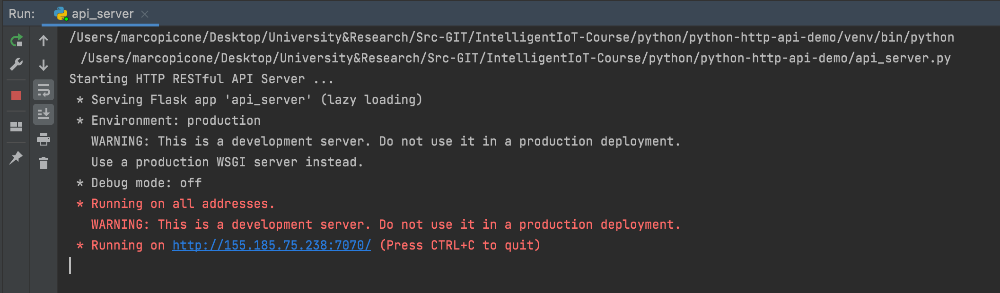
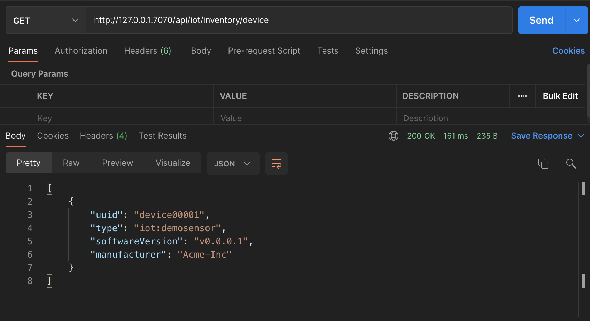
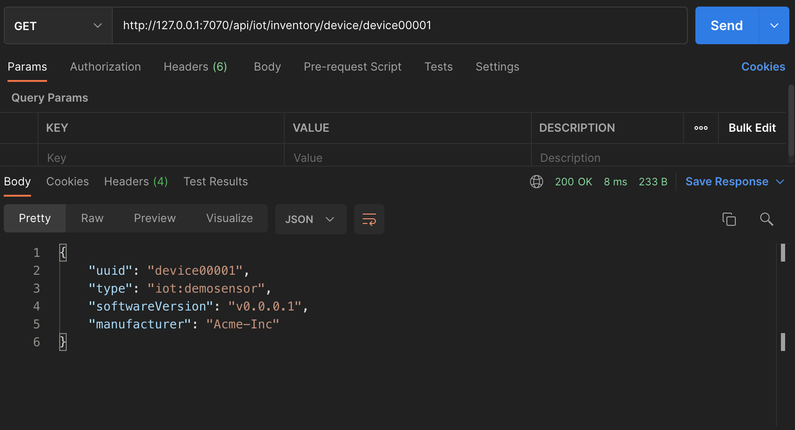
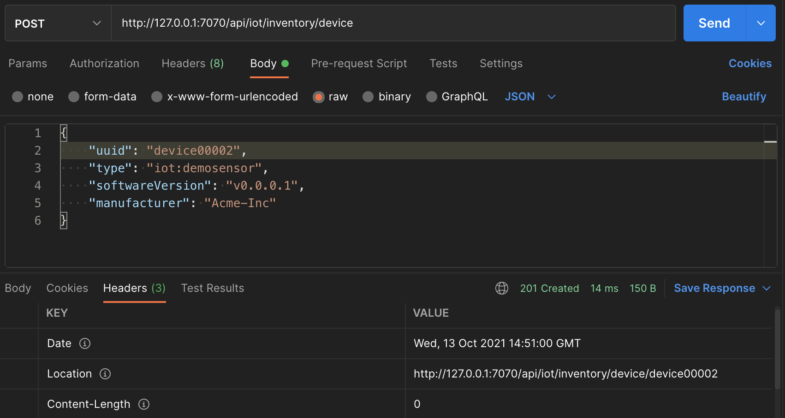

# Python - Laboratory RESTful HTTP API

This project is associated with the HTTP RESTful API Laboratory and it is used to show how to implement
a REST API through the use of the Python programming language and the following dependencies:

- Flask: https://flask.palletsprojects.com/en/2.3.x/
- Flask RESTful: https://flask-restful.readthedocs.io/en/latest/index.html

APIs are exposed through a configurable port (7070) and accessible locally at: http://127.0.0.1:7070/api/iot/inventory

In order to have additional information have a look at the official laboratory documentation and the step-by-step tutorial.

Laboratory structure and main sections are:

- [API HTTP RESTful Specifications](#api-http-restful-specifications)
- [Project Creation & Dependencies](#project-creation--dependencies)
- [Project Structure](#project-structure)
- [Running the Project](#running-the-project)
- [Model Classes](#model-classes)
- [Device Data Manager](#device-data-manager)
- [Creation of the Devices Resource](#creation-of-the-devices-resource)
- [HTTP Service Creation](#http-service-creation)
- [Creation of the Device Resource](#creation-of-the-device-resource)
- [Creating a New Device (HTTP - POST)](#creating-a-new-device-http---post)
- [Implementation of PUT and DELETE](#implementation-of-put-and-delete)

## API HTTP RESTful Specifications

In the following subsections, the specifications of the HTTP RESTful API to be implemented are provided. 
The base PATH to be used for the API is `api/iot/inventory`. 

An example of a complete URL associated with the PATH and the demo resource to be modeled (device) is: http://127.0.0.1:7070/api/iot/inventory/device.

### Device Data Structure

The data structure to be created for our IoT Device model should include the following fields:

- uuid (String): Unique identifier of the device. This ID will also be used as the key to identify it within the REST resources.
- type (String): Identifies the device type. Any value is allowed (e.g., temperature, humidity, demo sensor).
- softwareVersion (String): Represents the version of the software running on the device.
- manufacturer (String): Identifies the manufacturer of the device.

An example JSON representation of the resource to be modeled is as follows:

```json
{
    "uuid": "device00002",
    "type": "iot:demosensor",
    "softwareVersion": "v0.0.0.1",
    "manufacturer": "Acme-Inc"
}
```

### Endpoint HTTP RESTful to Design and Implement

For the device resource, the following endpoints are considered, 
along with their characteristics in terms of HTTP methods, body, headers, and response codes:

- **(READ DEVICE LIST) HTTP GET /device**: Returns the list of all devices registered on the server.
- Request Body: Empty
- Response:
  - Header: Content-Type: application/json
  - Body: [{…}, {…}, {Device Data Structure}]
  - Response Codes:
    - 200 OK
    - 400 Bad Request
    - 404 Not Found
    - 500 Internal Server Error

- **(CREATE NEW DEVICE) HTTP POST /device**: Create a new device.
- Request Body: {Device Data Structure}
- Response:
  - Header: Location: http://127.0.0.1:7070/api/iot/inventory/device/device00001
  - Body: Empty
  - Response Codes:
    - 201 Created
    - 400 Bad Request
    - 409 Conflict
    - 500 Internal Server Error

- **(READ DEVICE) HTTP GET /device/<device_id>**: Read the target device through its ID.
- Request Body: Empty
- Response:
  - Header: Content-Type: application/json
  - Body: {Device Data Structure}
  - Response Codes:
    - 200 OK
    - 400 Bad Request
    - 404 Not Found
    - 500 Internal Server Error

- **(UPDATE DEVICE) HTTP PUT /device/<device_id>**: Update a target device through its ID.
- Request Body: {Device Data Structure}
- Response:
  - Body: Empty
  - Response Codes:
    - 204 No Content
    - 400 Bad Request
    - 404 Not Found
    - 500 Internal Server Error

- **(REMOVE DEVICE) HTTP DELETE /device/<device_id>**: Delete the target device through its ID.
- Request Body: Empty
- Response:
  - Body: Empty
  - Response Codes:
    - 204 No Content
    - 400 Bad Request
    - 404 Not Found
    - 500 Internal Server Error

## Project Creation & Dependencies

The project uses the following dependencies:

- flask (Package Flask): Web Framework
- flask_restful (Package Flask-RESTful): Flask Plugin to build RESTful APIs

The project is managed with [uv](https://docs.astral.sh/uv/). Dependencies are declared in `pyproject.toml`,
locked in `uv.lock`, and the Python version (3.12) is pinned in `.python-version`.

Install uv (if needed) following the [official instructions](https://docs.astral.sh/uv/getting-started/installation/), e.g.:

```bash
curl -LsSf https://astral.sh/uv/install.sh | sh
```

Then, from the project root, create the virtual environment (`.venv`) and install all the dependencies with:

```bash
uv sync
```

uv automatically downloads the required Python version if it is not available on your machine.
The command also installs the project itself (the `iot_inventory` package) in editable mode, 
so that the package can be imported and the `iot-inventory-server` command is available.

In PyCharm, you can select the existing `.venv` interpreter or add a new "uv" interpreter from the interpreter settings.
Mark the `src/` folder as **Sources Root** (right click on the folder → _Mark Directory as_ → _Sources Root_).

### Using pip (alternative)

The `requirements.txt` file is **generated** from `uv.lock` and is kept only for pip-based workflows:

```bash
pip install -r requirements.txt
```

The file also contains the line `-e .`, which installs the project itself in editable mode (as `uv sync` does).
Do not edit it manually. After changing the dependencies, regenerate it with:

```bash
uv export --no-hashes --no-dev -o requirements.txt
```

## Project Structure

The project follows the `src` layout: the server code is the `iot_inventory` package in `src/`.

```
laboratory-python-http-rest-api/
├── pyproject.toml              # Project metadata, dependencies and entry points
├── uv.lock                     # Locked dependency versions (managed by uv)
├── .python-version             # Pinned Python version (3.12)
├── requirements.txt            # Generated from uv.lock for pip users
├── images/                     # Images used in this README
└── src/iot_inventory/          # Server application package
    ├── __init__.py
    ├── __main__.py             # Enables: python -m iot_inventory
    ├── api_server.py           # create_server_app() factory and main() entry point
    ├── model/
    │   └── device_model.py     # DeviceModel class
    ├── persistence/
    │   └── data_manager.py     # DataManager class (in-memory storage)
    └── resources/
        ├── devices_resource.py # DevicesResource class (/device)
        └── device_resource.py  # DeviceResource class (/device/<device_id>)
```

- **Server Application** (`src/iot_inventory`):
  - _api_server.py_: The main entry point of the project. It contains:
    - `create_server_app()`: the Flask App Factory that creates the application and registers the API resources. If no Data Manager is passed, a new empty one is created. Importing the module has no side effects and each call returns a new, independent app (useful for testing with `app.test_client()`).
    - `load_demo_data()`: adds a demo device to the Data Manager.
    - `main()`: creates the Data Manager, loads the demo data, creates the app and starts the server on port 7070.
  - _\_\_main\_\_.py_: calls `main()` so that the server can also be started with `python -m iot_inventory`.
- **Models** (`model/`):
  - _device_model.py_: Contains the `DeviceModel` class that represents an IoT device.
- **Persistence** (`persistence/`):
  - _data_manager.py_: Contains the `DataManager` class that stores the devices in memory (one independent dictionary for each `DataManager` instance).
- **Resources** (`resources/`):
  - _devices_resource.py_: Contains the `DevicesResource` class that handles the list of devices (`GET` and `POST` on `/device`).
  - _device_resource.py_: Contains the `DeviceResource` class that handles a single device (`GET`, `PUT` and `DELETE` on `/device/<device_id>`).

Each folder of the package contains an `__init__.py` file and internal modules are imported with 
absolute imports from the package, e.g.:

```python
from iot_inventory.model.device_model import DeviceModel
```

## Running the Project

The server is exposed as a command (`iot-inventory-server`) declared in the `[project.scripts]` section
of `pyproject.toml`. From the project root run:

```bash
uv run iot-inventory-server
```

Alternatively, you can run it as a module or execute the file directly:

```bash
uv run python -m iot_inventory
uv run src/iot_inventory/api_server.py
```

The server will start on all the network interfaces (`0.0.0.0`) and expose the API resources through the 
configured port by default (7070). Stop it with `CTRL+C`.

Since the app is built through the `create_server_app()` factory, it can also be started with the Flask CLI
(note that in this case the demo data are not loaded and, by default, the server listens only on `127.0.0.1`):

```bash
uv run flask --app "iot_inventory.api_server:create_server_app()" run --port 7070
```

With the server running, you can test the API with Postman (as shown in the following sections) or with `curl`, e.g.:

```bash
curl http://127.0.0.1:7070/api/iot/inventory/device
```

## Model Classes

> **Note:** the following sections describe the step-by-step construction of the project. 
> All the files are created inside the `src/iot_inventory/` package (see [Project Structure](#project-structure)) 
> and the complete, commented implementation of each step is available in the repository.

Inside the package `src/iot_inventory/`, create a folder named `model` (with an empty `__init__.py` file). 
Inside it, create the file `device_model.py` and the following class `DeviceModel`, 
which will represent the description of our IoT object model with the following fields:

- `uuid`: To uniquely identify the object.
- `type`: To specify the device type.
- `softwareVersion`: For the version of software running on the device.
- `manufacturer`: To identify the device manufacturer.

The created class should follow the approach explained in class, 
comprising the following components: i) Constructor for initializing all class attributes, and ii) `to_json` method for simplified serialization handling. The class example is provided in the following listing:

```python
import json

class DeviceModel:

    def __init__(self, uuid, type, softwareVersion, manufacturer):
        self.uuid = uuid
        self.softwareVersion = softwareVersion
        self.manufacturer = manufacturer
        self.type = type
        
    def to_json(self):
        return json.dumps(self, default=lambda o: o.__dict__)
```

## Device Data Manager

Inside the package `src/iot_inventory/`, create a new folder named `persistence` (with an empty `__init__.py` file)
which will contain the class for data storage (in this example, using a dictionary for in-memory storage). 
Within the persistence package, create the file `data_manager.py` with the following `DataManager` 
class responsible for handling all storage operations (create, update, and remove) for 
the project's devices using the previously created `DeviceModel` class:

```python
from iot_inventory.model.device_model import DeviceModel

class DataManager:

    def __init__(self):
        self.device_dictionary = {}

    def add_device(self, new_device):
        if isinstance(new_device, DeviceModel):
            self.device_dictionary[new_device.uuid] = new_device
        else:
            raise TypeError("Error adding new device ! Only DeviceModel are allowed !")

    def update_device(self, updated_device):
        if isinstance(updated_device, DeviceModel):
            self.device_dictionary[updated_device.uuid] = updated_device
        else:
            raise TypeError("Error updating the device ! Only DeviceModel are allowed !")

    def remove_device(self, device_uuid):
        if device_uuid in self.device_dictionary.keys():
            del self.device_dictionary[device_uuid]
```

The `device_dictionary` is created in the constructor (`__init__`) as an **instance attribute**: in this way each 
`DataManager` object has its own independent storage. Declaring it at class level (e.g., `device_dictionary = {}` 
directly in the class body) would instead create a single dictionary shared by all the instances of the class.

The methods within `DataManager` allow for creating, modifying, 
and removing devices from the dictionary and thus from the storage system. 
Specifically, note that the `add_device()` and `update_device()` 
methods validate the type of the parameter passed. In the case of an invalid type different from `DeviceModel`, 
they raise a system exception of type `TypeError` to signal to the calling method the error with the provided parameter.

## Creation of the Devices Resource

Inside the package `src/iot_inventory/`, create a new folder named `resources` (with an empty `__init__.py` file) 
that will contain the dedicated Python classes for describing the RESTful 
resources managed by the HTTP service. The Flask framework handles resources and their sub-elements differently. 
For this reason, it will be necessary to create separate classes for each type of resource. 
For example, to handle requests on `/device` and `/device/<device_id>`.

Firstly, let's begin with creating the class to handle requests on `/device` and enable the retrieval of the list of devices (GET) 
and their creation (POST).

Create a file named `devices_resource.py` containing the `DevicesResource` class with the following initial structure
(the imports of `request`, `Response` and `BadRequest` will be used later to implement the `POST` method):

```python
from flask import request, Response
from flask_restful import Resource
from werkzeug.exceptions import BadRequest
from iot_inventory.model.device_model import DeviceModel

class DevicesResource(Resource):

    def __init__(self, **kwargs):
        self.dataManager = kwargs['data_manager']

    def get(self):
        device_list = []
        for device in self.dataManager.device_dictionary.values():
            device_list.append(device.__dict__)
        return device_list, 200
```

The newly created class extends the Flask class Resource and has the following characteristics:

- The constructor allows retrieving variables passed during instantiation through a dictionary. In this specific case, we retrieve the `data_manager` variable of type `DataManager`, which will be stored as an attribute of the class (`self.dataManager`) to maintain a reference for working with the stored data. The passing of `DataManager` to the class will be explained in the next step.
- The Flask framework, through the base class Resource, enables quick association of HTTP methods (GET, POST, PUT, DELETE) with Python functions named the same way (get, post, put, delete). In the current case, for instance, we can handle GET requests by redefining the method using the syntax: `def get(self):`. As illustrated later, these methods can also have parameters associated with the path and are usable within the function.

## HTTP Service Creation

Inside the package `src/iot_inventory/`, create a new file named `api_server.py` that will contain the definition of the HTTP server and its 
REST resources to be managed. The following listing presents the structure of the module:

```python
from flask import Flask
from flask_restful import Api
from iot_inventory.resources.devices_resource import DevicesResource
from iot_inventory.persistence.data_manager import DataManager
from iot_inventory.model.device_model import DeviceModel

ENDPOINT_PREFIX = "/api/iot/inventory"

DEFAULT_HOST = "0.0.0.0"
DEFAULT_PORT = 7070


def create_server_app(data_manager=None):
    if data_manager is None:
        data_manager = DataManager()

    app = Flask(__name__)
    api = Api(app)

    api.add_resource(DevicesResource, ENDPOINT_PREFIX + '/device',
                     resource_class_kwargs={'data_manager': data_manager},
                     endpoint="devices",
                     methods=['GET', 'POST'])

    return app


def load_demo_data(data_manager):
    demo_device = DeviceModel("device00001", "iot:demosensor", "v0.0.0.1", "Acme-Inc")
    data_manager.add_device(demo_device)


def main():
    data_manager = DataManager()
    load_demo_data(data_manager)

    app = create_server_app(data_manager)

    print("Starting HTTP RESTful API Server ...")

    app.run(host=DEFAULT_HOST, port=DEFAULT_PORT)


if __name__ == '__main__':
    main()
```

In the provided code, the following aspects are highlighted:

- Imports necessary classes and references using absolute imports from the `iot_inventory` package.
- Defines the API endpoint prefix and the default host and port of the server as constants.
- `create_server_app()` implements the **App Factory** pattern:
  - Creates a Flask server and an API through Flask-RESTful using the statements `app = Flask(__name__)` and `api = Api(app)`. These variables are used to configure the REST resources and the server's operating parameters.
  - Receives the `DataManager` used to store the data (if it is not provided, a new empty one is created). This object is then passed to the resource classes for precise handling of data read and write functionalities.
  - Adds a new resource of the type `DevicesResource`, previously created and associated with the endpoint `/api/iot/inventory/device`, using the `api.add_resource` method. Additionally, it passes the `DataManager` reference to the resource through `resource_class_kwargs`, specifies an endpoint name, and defines the supported methods (Flask will automatically respond with a 405 Method Not Allowed for all other methods).
  - Returns the configured app without starting it.
- `load_demo_data()` creates a demo `DeviceModel` object and inserts it into the `DataManager` for testing purposes.
- `main()` is the entry point of the project: it creates the `DataManager`, loads the demo data, creates the app and starts the server 
on the port `7070` binding all the IPs and interfaces (specifying `0.0.0.0`).

Creating the app inside a function (instead of at module level) means that importing the module has no side effects 
(nothing is printed or created), each call to `create_server_app()` returns a new and independent app 
(e.g., to be used in tests through `app.test_client()`), and the app can also be started with the Flask CLI.

The project also contains the file `__main__.py` (which simply calls `main()` to enable `python -m iot_inventory`) and 
the following entry in `pyproject.toml`, which creates the `iot-inventory-server` command:

```toml
[project.scripts]
iot-inventory-server = "iot_inventory.api_server:main"
```

With the code defined above, you can launch the server (e.g., with `uv run iot-inventory-server`, see [Running the Project](#running-the-project)) 
and test the GET request to retrieve the list of registered devices using Postman. 
Once the service is launched, check the output in the console as shown in the following Figure.



Subsequently, test the service using the Postman HTTP REST client with the following parameters:

- Method: GET 
- URL: http://127.0.0.1:7070/api/iot/inventory/device

The results on Postman are illustrated in the following Figure:



## Creation of the Device Resource

Inside the `resources` folder, create a file named `device_resource.py` containing the `DeviceResource` 
class to manage access to the resource associated with a single device, rather than a list of devices. 
The structure of the class is as follows (as before, the additional imports will be used later for the `PUT` method):

```python
from flask import request, Response
from flask_restful import Resource
from werkzeug.exceptions import BadRequest
from iot_inventory.model.device_model import DeviceModel

class DeviceResource(Resource):

    def __init__(self, **kwargs):
        self.dataManager = kwargs['data_manager']

    def get(self, device_id):
        if device_id in self.dataManager.device_dictionary:
            return self.dataManager.device_dictionary[device_id].__dict__, 200
        else:
            return {'error': "Device Not Found !"}, 404
```

The newly created class still extends the Flask class `Resource` 
but aims to handle requests arriving on paths of the form `/device/<device_id>`. 
The class possesses the following characteristics:

- The constructor allows retrieving variables passed during instantiation through a dictionary. 
In this specific case, we retrieve the `data_manager` variable of type `DataManager`, 
which will be stored as an attribute of the class to maintain a reference for working with the stored data.
- Definition of the method `def get(self, device_id):` to handle GET requests on the resource. 
In this case, there's an additional parameter that will be correctly passed by the Flask framework and will 
contain the value of the `device_id` passed in the path. For example, the value could be `device00001` with a URL structure like `http://127.0.0.1:7070/api/iot/inventory/device/device00001`

In order to test the service, it's necessary to first add the new resource and its management to the previously created 
`api_server.py` file. The code to be inserted consists of the correct reference 
import (`from iot_inventory.resources.device_resource import DeviceResource`) and then the following method call 
inside `create_server_app()`, after the registration of the `DevicesResource`:

```python
api.add_resource(DeviceResource, ENDPOINT_PREFIX + '/device/<string:device_id>',
                 resource_class_kwargs={'data_manager': data_manager},
                 endpoint='device',
                 methods=['GET', 'PUT', 'DELETE'])
```

The newly integrated code allows adding the new resource to the server and associating it with requests that match the specified 
path `/device/<string:device_id>`. 
The format `<string:device_id>` not only specifies the variable's key to use `device_id`, 
but also its type (in this case, `string` or, for example, `int`). 
As explained earlier, Flask will pass the value of the path parameter to the 
`get` method of the previously created `DeviceResource` class. 

Subsequently, test the service using the Postman HTTP REST client with the following parameters:

- Method: GET 
- URL: http://127.0.0.1:7070/api/iot/inventory/device/device00001

The results on Postman are illustrated in the following figure:



## Creating a New Device (HTTP - POST)

In order to create a new device on the newly created server, it's necessary to handle the POST 
method in the `DevicesResource` class to respond appropriately to `POST` requests on the path `/device`. 
Specifically, add the following method to the `DevicesResource` class:

```python
def post(self):
    try:
        json_data = request.get_json(force=True)
        device_model = DeviceModel(**json_data)
        if device_model.uuid in self.dataManager.device_dictionary:
            return {'error': "Device UUID already exists"}, 409
        else:
            self.dataManager.add_device(device_model)
            return Response(status=201, headers={"Location": request.url + "/" + device_model.uuid})
    except BadRequest:
        return {'error': "Invalid JSON ! Check the request"}, 400
    except TypeError:
        return {'error': "Invalid device data ! Check the request fields"}, 400
    except Exception as e:
        return {'error': "Generic Internal Server Error ! Reason: " + str(e)}, 500
```

Specifically, the created code enables the following operations:

- Deserializes the received JSON body using the method `request.get_json(force=True)`, where the 
`request` object is provided by Flask (imported with `from flask import request`) and represents the current HTTP request. 
The use of the parameter `force=True` enforces deserialization even if the Content-Type specified 
by the client is not `application/json`. While the client should ideally always specify the correct type, 
forcing deserialization can help mitigate minor client errors.
- Transforms the deserialized generic JSON object into the `DeviceModel` class using 
the syntax `device_model = DeviceModel(**json_data)`.
- Checks if a device with the same `UUID` already exists in the `DataManager`. 
If so, it responds with an error message and a response code of `409 CONFLICT`.
- If the device is new, it adds it to the `DataManager` and responds with a 
`201` response code and the `Location` header containing the URL to the new resource. 
In this case, the response uses the `Response` class to specify an empty body, 
which wouldn't be possible using the compact form `return <object>, <response_code>`.
So we use: `Response(status=201, headers={"Location": request.url + "/" + device_model.uuid})`
- Handles client errors with a `400 Bad Request` response, catching the specific exceptions before the generic one 
(which is reported as `500 Internal Server Error`):
  - `BadRequest` (from `werkzeug.exceptions`): raised by `request.get_json()` when the body is not valid JSON. 
  Note that Flask does not raise a `JSONDecodeError` in this case, so catching `JSONDecodeError` would not work.
  - `TypeError`: raised by `DeviceModel(**json_data)` when the JSON fields do not match the constructor parameters 
  (missing or unexpected fields) or when the body is not a JSON object (e.g., a list or `null`).

Use Postman to make a POST request with the following characteristics:

- Method: POST
- URL: http://127.0.0.1:7070/api/iot/inventory/device
- Body Type: RAW
- Format: JSON
- Body: As shown in the following listing and in Figure

```json
{
    "uuid": "device00002",
    "type": "iot:demosensor",
    "softwareVersion": "v0.0.0.1",
    "manufacturer": "Acme-Inc"
}
```



Note in the Postman response how the response code is 201, there's no body present, 
and among the headers, the Location header contains the URL to which the client can 
make a new GET request to retrieve the representation of the created resource. 
Perform a test with a GET request to verify the proper functioning.

The same request can be executed with `curl`:

```bash
curl -i -X POST -H "Content-Type: application/json" \
     -d '{"uuid": "device00002", "type": "iot:demosensor", "softwareVersion": "v0.0.0.1", "manufacturer": "Acme-Inc"}' \
     http://127.0.0.1:7070/api/iot/inventory/device
```

## Implementation of PUT and DELETE

As additional exercises, implement and add the following methods to the `DeviceResource` class:

- `def put(...)` to be associated with the HTTP `PUT` method for updating an existing resource, 
performing appropriate checks on the request, resource ID, and body. In case of success, 
the response code should be `204` with no body, while in case of error, use `400` for an invalid request 
(invalid JSON, invalid device fields or a mismatch between the UUID in the body and the one in the URL), 
`404` for a resource not found or `500` in case of a server error. 
In all the error cases, specify a message in the body explaining the problem details.
- `def delete(...)` to be associated with the HTTP `DELETE` method for deleting a resource by its ID. 
In this case, it's necessary to validate and check the presence of the requested resource and respond with 
`204` with no body in case of success, `404` for a resource not found, or `500` in case of a server error. 
In both error cases, specify a message in the body explaining the problem details.

Below are the method declarations to be used: Flask-RESTful automatically associates them with the 
corresponding HTTP methods through their names. 
The student should fill in and complete these methods correctly to define their proper REST behavior.

```python
def put(self, device_id):
    ... [TO BE COMPLETED] ...
```

```python
def delete(self, device_id):
    ... [TO BE COMPLETED] ...
```

A reference solution is available in `src/iot_inventory/resources/device_resource.py`.
